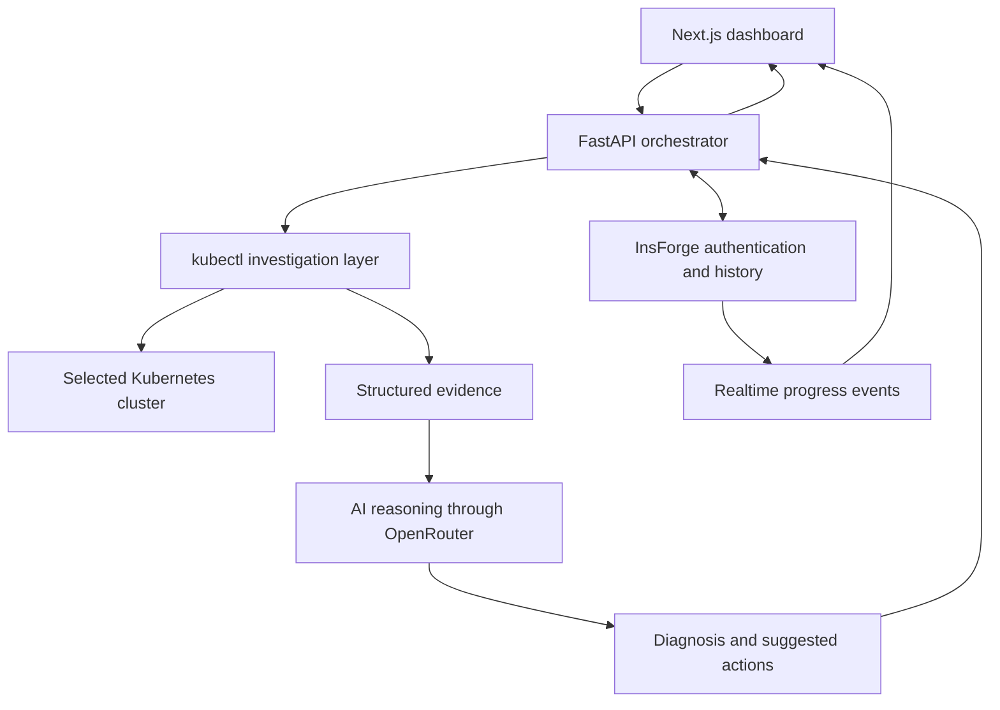

# AI Kubernetes Agent

An on-demand Kubernetes troubleshooting application that collects cluster evidence, uses an AI model to explain observed failures, and presents suggested next steps in a dashboard.

Built with **Next.js, FastAPI, kubectl, OpenRouter, and InsForge**. Developed and demonstrated on Windows using Docker Desktop and kind.

> Suggested commands are displayed for review. The application does not execute fixes. It is a development and learning project, not a Kubernetes operator or an autonomous remediation system.

## Features

- Sign up and sign in through InsForge authentication.
- Select a cluster context from the kubeconfig mounted into the backend.
- Inspect pods, bounded log tails, events, deployments, Services, and EndpointSlices.
- Follow investigation progress through InsForge realtime updates.
- Receive an evidence-based diagnosis, suggested commands, prevention advice, and a confidence estimate.
- Save and review investigation history associated with the signed-in user and selected context.
- Report partial results when a collector or AI request fails.

A listed cluster context does not guarantee that its endpoint is reachable or that its credentials work inside the backend container.

## Architecture



FastAPI remains the orchestrator. InsForge provides authentication, history, and realtime functionality. The current model integration calls OpenRouter directly; an InsForge Model Gateway subscription is not required for that route.

## Technology stack

| Layer | Technology |
| --- | --- |
| Frontend | Next.js, TypeScript, Tailwind CSS, Axios, TanStack Query |
| Backend | Python 3.12+, FastAPI, Uvicorn, Pydantic, Loguru, HTTPX |
| Cluster access | kubectl subprocess commands; no Kubernetes Python SDK |
| AI | OpenRouter-compatible chat completions |
| Identity and persistence | InsForge authentication, PostgreSQL history, realtime |
| Local runtime | Docker and Docker Compose |
| Local test clusters | kind |

## Prerequisites

- Docker Engine with Docker Compose, or Docker Desktop using Linux containers on Windows.
- kubectl and access to a Kubernetes cluster.
- kind if you want to create local test clusters.
- An InsForge project with authentication, database, and realtime features configured.
- An OpenRouter API key and an available model compatible with the application's JSON response requirements.
- Enough disk space for images, dependencies, build cache, and cluster workloads.

Health checks can run without a cluster or model key. The complete dashboard workflow requires InsForge configuration, cluster access, and a working AI provider connection.

## Quick start: Windows and Docker Desktop

The commands below are for **Windows Command Prompt**. Run Compose commands from the repository root.

### 1. Get the project

```cmd
git clone https://github.com/rayeesa-1/AI-Kubernetes-Agent.git
cd AI-Kubernetes-Agent
```

If you already have the project, open a terminal in that folder instead. Private repositories require GitHub authentication.

### 2. Configure environment variables

```cmd
copy .env.example .env
notepad .env
```

Only copy the example when creating your local configuration for the first time. Preserve an existing populated `.env`.

Configure the variables used by your version of `docker-compose.yml`:

```dotenv
OPENROUTER_API_KEY=replace-with-your-openrouter-key
OPENROUTER_MODEL=replace-with-an-available-model-id

INSFORGE_URL=https://your-project-api-address
INSFORGE_API_KEY=replace-with-your-server-side-project-key
INSFORGE_ANON_KEY=replace-with-your-project-anonymous-key
SESSION_COOKIE_SECURE=false

NEXT_PUBLIC_API_BASE_URL=http://localhost:8000
LLM_TIMEOUT_SECONDS=15
LLM_MAX_RETRIES=0
LLM_MAX_TOKENS=4000
KUBECONFIG_PATH=/kube/config
```

Use real values locally; do not commit them. The anonymous key is required by signup implementations that explicitly request it. It is different from the privileged project API key. Never substitute the privileged key into a client-side or anonymous-key setting.

Use the exact model ID supplied by OpenRouter. Free models have availability and usage limits. `LLM_MAX_RETRIES=0` avoids automatic retries during initial testing; it does not bypass rate limits.

### 3. Initialize InsForge

In your dedicated InsForge project, open **SQL Editor** and run these files in order:

1. [`deploy/insforge-phase4.sql`](deploy/insforge-phase4.sql)
2. [`deploy/insforge-phase5.sql`](deploy/insforge-phase5.sql)

If the hosted editor rejects transaction controls, omit standalone `BEGIN;` and `COMMIT;` wrappers. Keep function-body `BEGIN`/`END` blocks and all permission policies intact.

The scripts configure `investigations`, user-scoped reads, progress broadcasts, and cluster metadata. Current progress is stored in the table's `progress` column; a separate progress table is not required by this implementation.

Configure signup and any email verification required by your project. Alternatively, provision an application user in InsForge and use sign-in. Your InsForge dashboard account is not automatically an application account.

### 4. Configure access to a kind cluster

Verify Docker is running:

```cmd
docker info
kind get clusters
```

If you do not have a test cluster, create one:

```cmd
kind create cluster --name ai-agent-cluster
```

Export a separate configuration using the internal address reachable from Docker containers:

```cmd
kind export kubeconfig --name ai-agent-cluster --internal --kubeconfig kind-backend.kubeconfig
```

The backend Compose configuration needs both the read-only file mount and access to kind's Docker network. Merge these settings into the existing file; preserve its other environment variables and services:

```yaml
services:
  backend:
    environment:
      KUBECONFIG_PATH: /kube/config
      KUBECONFIG: /kube/config
    volumes:
      - ./kind-backend.kubeconfig:/kube/config:ro
    networks:
      - default
      - kind

networks:
  default: {}
  kind:
    external: true
    name: kind
```

This is a partial configuration example, not a replacement for the entire Compose file. If your checkout uses `docker-compose.kind.yml`, follow [`docs/phase-2-windows.md`](docs/phase-2-windows.md) and check that override for additional volume settings.

### 5. Build and start

```cmd
docker compose up -d --build
docker compose ps
```

| Service | Address |
| --- | --- |
| Dashboard | http://localhost:3000 |
| Backend health | http://localhost:8000/health |
| API documentation | http://localhost:8000/docs |

Verify cluster connectivity from inside the backend:

```cmd
docker compose exec backend kubectl get nodes
```

Sign up or sign in, select the intended cluster, and click **Investigate Cluster**.

Expected health response:

```json
{"status":"healthy","service":"ai-kubernetes-agent"}
```

The health endpoint checks application availability, not end-to-end Kubernetes, InsForge, or AI health.

## Multiple clusters

The dashboard reads contexts from the backend's mounted kubeconfig. It does not discover Azure subscriptions or automatically read your Windows configuration.

```cmd
kubectl config get-contexts
docker compose exec backend kubectl config get-contexts
```

For an existing merged file named `backend-all.kubeconfig`, change the backend mount to:

```yaml
volumes:
  - ./backend-all.kubeconfig:/kube/config:ro
```

Keep both kubeconfig environment variables pointing to `/kube/config`, recreate the backend, and refresh the dashboard's cluster list.

Each context needs a reachable endpoint and valid authentication inside the container. Local kind clusters need suitable Docker network access. Azure contexts may require additional authentication tools and configuration; Windows credentials do not automatically become available in a Linux container.

Changing the Windows current context does not change which file is mounted into the backend. Investigations should explicitly target the selected dashboard context.

## Run and validate an investigation

1. Confirm the selected cluster is reachable from the backend.
2. Sign in and choose that context in the dashboard.
3. Start one investigation and watch the progress stages.
4. Review the evidence, diagnosis, suggested actions, and missing evidence.
5. Refresh the page and confirm history persists.
6. Verify a different application user cannot access the first user's history.

Relevant routes include `GET /health`, `GET /clusters`, `POST /investigate`, and investigation-history endpoints. Use the running application's `/docs` page for current request schemas and authentication requirements.

### Understanding results

- **Completed** means processing finished, not that the cluster is healthy.
- **Partial** means part of collection or AI analysis failed; inspect the individual stages.
- **No failure observed** applies only to collected evidence. It does not prove DNS, network connectivity, or every workload is healthy.
- Confidence is an uncalibrated estimate, not a measured probability.
- Suggested commands require review of their context, namespace, and effects before manual execution.

## Failure testing

Use only a local or explicitly authorized test cluster. Run one scenario at a time in a dedicated namespace. The test manifests are under [`deploy/failures`](deploy/failures).

| Manifest | Intended failure | Evidence to verify |
| --- | --- | --- |
| `crashloop.yaml` | Repeated startup failure | Container waiting state, restarts, startup logs |
| `imagepull.yaml` | Image download failure | Waiting reason and image-pull event messages |
| `oom.yaml` | Memory limit exceeded | Current or previous termination reason `OOMKilled` |
| `selector.yaml` | Service selector mismatch | Pod labels, Service selector, and EndpointSlices |

Review each manifest's namespace and resource limits before applying it. A registry, certificate, or scheduling failure can prevent the intended scenario from starting.

For every scenario, verify the failure with kubectl, investigate through the dashboard, check that the diagnosis matches evidence, apply a reviewed manual fix, and investigate again. Then remove only that scenario's resources. Historical events can remain after recovery and should not be treated as proof of a current failure.

Automated checks, where the dependencies are installed:

```cmd
cd backend
python -m unittest discover -s tests
```

From a separate terminal in `frontend`:

```cmd
npm ci
npm run typecheck
npm run build
```

Automated checks do not replace live validation of cluster access, provider availability, authentication, realtime delivery, or user isolation.

## Troubleshooting

| Symptom | What to check |
| --- | --- |
| Docker engine pipe not found | Start Docker Desktop and wait for the Linux engine; run `docker info`. |
| Image download certificate error | Check approved proxy/CA configuration; do not disable TLS verification. |
| kubectl tries `localhost:8080` | Check the mounted kubeconfig, its container path, and current context. |
| Only one cluster appears | Compare backend contexts with Windows contexts; verify the merged-file mount. |
| InsForge history returns 404/503 | Verify the project URL, server key, SQL setup, and expected table. |
| Signup requests an anonymous key | Configure the project's actual anonymous key and pass it through Compose. |
| OpenRouter 402 | Check credits, model pricing, and account/key spending limits. |
| OpenRouter 429 | Stop repeated requests and inspect provider/account limits and retry guidance. |
| Invalid or incomplete AI completion | Check model support, output-token budget, and sanitized completion diagnostics. |
| Reading Logs fails | Inspect pod/container state and the specific collection error; a container that never started may have no logs. |
| Progress says complete but a pod is unhealthy | Completion describes the collection stage, not resource health. |

Useful commands:

```cmd
docker compose logs --tail 100 backend
docker compose logs --tail 100 frontend
docker compose exec backend kubectl config get-contexts
```

After changing backend environment values or mounts:

```cmd
docker compose up -d --no-deps --force-recreate backend
```

After changing application code:

```cmd
docker compose up -d --build
```

Next.js embeds `NEXT_PUBLIC_` settings at build time. Rebuild the frontend when changing its public API base URL. Never put private keys in public frontend variables.

## Repository structure

```text
backend/app/api/          API and authentication routes
backend/app/core/         Configuration and logging
backend/app/kubernetes/   kubectl execution and evidence collectors
backend/app/ai/           Prompting, model client, and diagnosis validation
backend/app/services/     Investigation orchestration and persistence
backend/app/models/       Response and diagnosis models
backend/tests/            Backend tests
frontend/src/             Dashboard, hooks, API client, and types
deploy/                   Database setup, RBAC, and failure scenarios
docs/                     Detailed setup and validation guides
scripts/                  Local cluster/configuration helpers
```

## Credentials and permissions

- Keep populated `.env` files, kubeconfigs, private keys, logs, and backups out of Git.
- Keep only placeholder values in committed `.env.example` files.
- Keep the privileged InsForge key and OpenRouter key server-side.
- Use dedicated, least-privilege Kubernetes credentials. See [`deploy/investigator-rbac.yaml`](deploy/investigator-rbac.yaml); exporting kind credentials does not itself restrict their permissions.
- Inspect and redact sensitive application data before sending evidence to an external model provider. Do not assume every secret format is detected.
- Rotate any credential that has been exposed; deleting it from a file does not revoke it.

## Scope and deployment

This repository currently documents a local Docker Compose workflow. Pushing it to GitHub does not deploy it, and another person's browser cannot access your laptop through a `localhost` URL.

A public deployment needs a separate review of HTTPS, session-cookie settings, cluster authorization, network access, concurrency, and external-provider data handling. Do not expose an administrative kubeconfig through a public multi-user demo.

See [`docs/phase-4-dashboard.md`](docs/phase-4-dashboard.md) and [`docs/PHASE5-START-HERE.md`](docs/PHASE5-START-HERE.md) for implementation-specific setup and validation notes.
